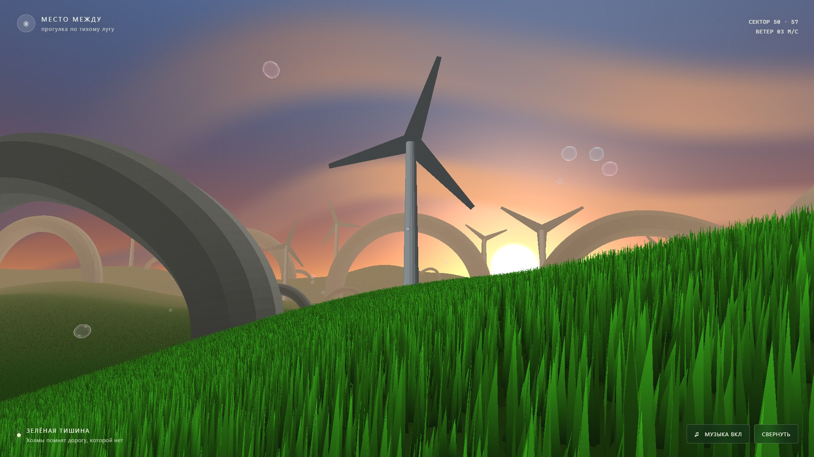

# Тихий луг

Процедурная прогулка от первого лица на WebGPU: мир размером около 1000 × 1000 м с холмистым рельефом, густой колышущейся травой, четырьмя упорядоченными арочными маршрутами, ветрогенераторами, полевыми цветами и поднимающимися мыльными пузырями.




## Запуск

Нужен актуальный Chrome или Edge с поддержкой WebGPU. Откройте папку проекта в терминале и запустите локальный сервер:

```powershell
python -m http.server 8000
```

Перейдите на `http://localhost:8000`.

## Управление

- `W`, `A`, `S`, `D` — движение
- Мышь — осмотр
- `Пробел` — прыжок
- `Shift` — ускорение
- `M` — включить или выключить музыку
- `Esc` — поставить прогулку на паузу и освободить мышь; кнопки звука и полноэкранного режима остаются доступны
- Кнопка «Музыка» — включить или выключить зацикленный саундтрек и эмбиент
- Кнопка «Развернуть» — полноэкранный режим

Музыка запускается автоматически при нажатии «Начать прогулку» и повторяется без пауз. Если браузер блокирует автовоспроизведение, включите её кнопкой «Музыка» или клавишей `M`.
